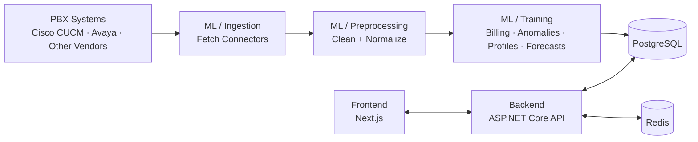

# TeleSpy

AI-driven SIM management and telecom cost accountability system, built for Kenya Airways as a university capstone project.

TeleSpy tracks which employee holds which SIM card and desk extension, transforms raw PBX Call Detail Records (CDRs) into per-employee and per-department costs in KES, and uses machine learning to flag unusual calling behaviour, group employees by usage pattern, and forecast next month's departmental spend.

## Contents

* [Features](#features)
* [Architecture](#architecture)
* [Tech Stack](#tech-stack)
* [Repository Layout](#repository-layout)
* [Getting Started](#getting-started)

  * [Prerequisites](#prerequisites)
  * [1. Backend API](#1-backend-api)
  * [2. Frontend](#2-frontend)
  * [3. ML Pipeline](#3-ml-pipeline)
* [Roles and Access](#roles-and-access)
* [API Overview](#api-overview)
* [ML Pipeline in Detail](#ml-pipeline-in-detail)
* [Billing Rules](#billing-rules)
* [Security](#security)
* [Testing and CI](#testing-and-ci)

## Features

* **SIM inventory and allocation** — Register SIM cards, assign them to employees, unassign them, and maintain the full allocation history.
* **Employees and departments** — Manage staff, extension codes, and each department's telecom budget.
* **CDR ingestion** — Pull call records from Cisco CUCM via SFTP, Avaya via a real-time TCP stream, or other vendors that provide files over SFTP. CDRs can also be uploaded through the web UI.
* **Call classification and billing** — Every call is classified as Internal, External (Kenyan), or International and priced using administrator-managed rate tables.
* **Anomaly detection** — Isolation Forest flags unusual calls for administrator review and resolution.
* **Usage profiling** — KMeans groups employees into low, moderate, and high usage tiers.
* **Spend forecasting** — Prophet forecasts next-period spend for each department.
* **Budgets and invoices** — Per-role monthly cost ceilings, over-limit reports, and monthly invoice emails.
* **Audit log** — Sensitive changes are recorded and made visible to administrators.
* **Secure sign-in** — Email OTP as a second factor, account lockout, password history, and one active session per user.

## Architecture



The three major parts are deliberately separated:

| Part             | Responsibility                                                                                       |
| ---------------- | ---------------------------------------------------------------------------------------------------- |
| `Frontend/`      | Presentation only. A role-gated Next.js client with no business logic.                               |
| `BackendDotNet/` | REST API. Owns authentication, access control, database schema, and CRUD operations.                 |
| `ML/`            | Batch jobs. Fetches and cleans CDRs, prices calls, and writes ML results directly into the database. |

The API does not run ML processes in-process. The ML jobs write their results (`usage_summaries`, `anomaly_flags`, `usage_profiles`, and `forecast_results`) to the same database that the API reads from, with each job running on its own schedule.

## Tech Stack

| Layer    | Technology                                                                                                    |
| -------- | ------------------------------------------------------------------------------------------------------------- |
| Frontend | Next.js 16, React 19, TypeScript, Tailwind CSS 4, shadcn/ui, TanStack Query and Table, Zustand, Zod, Recharts |
| Backend  | ASP.NET Core on .NET 10, Entity Framework Core 10, JWT, BCrypt                                                |
| Data     | PostgreSQL, SQLite for local development, Redis                                                               |
| ML       | Python, pandas, NumPy, scikit-learn, Isolation Forest, KMeans, Prophet, Paramiko                              |
| Tooling  | pnpm, Vitest, Playwright, axe-core, ESLint, Prettier, Husky, GitHub Actions                                   |

## Repository Layout

```text
TeleSpy/
├── BackendDotNet/              ASP.NET Core API
│   ├── Api/                    Controllers, one per domain
│   ├── Core/                   Config, JWT, middleware, role attributes, startup
│   ├── Models/                 EF Core entities and DbContext
│   ├── Services/               Allocation, audit, cache, mail, call classification
│   ├── Migrations/             EF Core migrations
│   ├── Program.cs              Application entry point
│   └── Seed.cs                 Demo data generator
│
├── Frontend/                   Next.js web client
│   ├── src/app/                Routes (dashboard, SIMs, employees, analytics, ...)
│   ├── src/features/           Feature modules (auth, billing, anomalies, ingestion)
│   ├── src/components/         Shared UI and layout
│   ├── src/lib/                API client, auth session store, helpers
│   └── tests/                   Playwright end-to-end tests
│
└── ML/
    ├── ingestion/              CDR fetch connectors (CUCM, Avaya, generic SFTP)
    ├── preprocessing/          CDR cleaning and normalization
    ├── training/               Billing, anomaly detection, profiling, forecasting
    └── data/                   cdr_incoming/, processed/, archive/
                                (contents not committed)
```

## Getting Started

### Prerequisites

| Tool       | Version                         |
| ---------- | ------------------------------- |
| .NET SDK   | 10.0                            |
| Node.js    | 20.9 or newer (CI uses Node 22) |
| pnpm       | 11                              |
| Python     | 3.10 or newer                   |
| PostgreSQL | 14 or newer                     |
| Redis      | Any recent version              |

### 1. Backend API

Create `BackendDotNet/.env`.

The four secrets marked as required must be set or the API will refuse to start.

```dotenv
ASPNETCORE_ENVIRONMENT=Development

# Required secrets
# Generate each with: openssl rand -base64 32
SECRET_KEY=
JWT_SECRET_KEY=
FIELD_ENCRYPTION_KEY=

# Generate with: openssl rand -hex 32
BLIND_INDEX_KEY=

# Database and cache
DATABASE_URL=
REDIS_URL=

# Frontend origins allowed to call the API
FRONTEND_ORIGINS=
# Outbound email
MAIL_SERVER=localhost
MAIL_PORT=587
MAIL_USE_TLS=true
MAIL_USERNAME=
MAIL_PASSWORD=
MAIL_DEFAULT_SENDER=TeleSpy <no-reply@telespy.local>

# true = emails are written to the API log instead of being sent
MAIL_SUPPRESS_SEND=true
```

#### Optional Settings

| Variable                               |   Default | Purpose                                              |
| -------------------------------------- | --------: | ---------------------------------------------------- |
| `JWT_ACCESS_TOKEN_EXPIRES_MINUTES`     |      `15` | Access token lifetime                                |
| `JWT_REFRESH_TOKEN_EXPIRES_DAYS`       |       `7` | Refresh token and session lifetime                   |
| `JWT_MFA_TOKEN_EXPIRES_MINUTES`        |       `5` | Token lifetime between password and OTP verification |
| `MFA_OTP_EXPIRES_MINUTES`              |       `5` | Login code lifetime                                  |
| `PASSWORD_RESET_TOKEN_EXPIRES_MINUTES` |      `30` | Password reset token lifetime                        |
| `DPA_KE_POLICY_VERSION`                | `2026-01` | Privacy policy version users consent to              |

For a quick local setup without PostgreSQL, point `DATABASE_URL` to a SQLite database:

```text
sqlite:///telespy.db
```

Then apply the migrations, optionally load demo data, and start the server:

```bash
cd BackendDotNet

dotnet tool install --global dotnet-ef   # Once, if you do not have it
dotnet ef database update                # Create the schema
dotnet run -- --seed                     # Optional: load demo data
dotnet run --urls http://localhost:5299  # Start the API
```

Check that the API is running:

```bash
curl http://localhost:5299/health
```

The seed creates:

* Five departments
* Three telco plans
* An administrator
* A manager for each department
* Employees
* SIM allocations
* Three months of call history

The seed skips itself if any department already exists.

Demo account credentials are defined at the top of `BackendDotNet/Seed.cs`.

> **Warning:** Never run the seed against a real production environment.

With `MAIL_SUPPRESS_SEND=true`, login codes are printed in the API log rather than emailed, allowing local authentication without an SMTP server.

### 2. Frontend

```bash
cd Frontend

pnpm install
cp .env.example .env.local
pnpm dev
```

Open:

```text
http://localhost:3000
```

`.env.local` contains:

```text
NEXT_PUBLIC_API_URL=http://localhost:5299
```

#### Common Scripts

| Command               | Description                                       |
| --------------------- | ------------------------------------------------- |
| `pnpm dev`            | Start the development server                      |
| `pnpm build`          | Create a production build                         |
| `pnpm lint`           | Run ESLint                                        |
| `pnpm typecheck`      | Run TypeScript checks                             |
| `pnpm test`           | Run Vitest unit tests                             |
| `pnpm test:e2e`       | Run Playwright end-to-end and accessibility tests |
| `pnpm check-contrast` | Check WCAG 2.2 AA contrast requirements           |

### 3. ML Pipeline

```bash
cd ML

python -m venv .venv
source .venv/bin/activate
pip install -r requirements.txt
```

The ML jobs read `DATABASE_URL` from `BackendDotNet/.env`, so the backend must be configured and migrated first.

No separate database configuration is required.

Place CDR files in:

```text
ML/data/cdr_incoming/
```

Then run the stages in order:

```bash
python preprocessing/run_preprocessing.py
```

Then:

```bash
cd training

python billing.py
python anomaly_detection.py
python usage_profiling.py
python forecasting.py
```

To run all four training jobs during development, open:

```text
ML/training/run_ml.ipynb
```

## Roles and Access

There are three roles: **Admin**, **Manager**, and **Employee**.

The API enforces authorization on every request. The frontend hides navigation that a role cannot use, but this is only a convenience; security is enforced by the backend.

| Area                                             | Admin | Manager | Employee |
| ------------------------------------------------ | :---: | :-----: | :------: |
| Own settings, usage, and profile                 |  Yes  |   Yes   |    Yes   |
| View SIMs, employees, and usage events           |  Yes  |   Yes   |    No    |
| View analytics, forecasts, and budgets           |  Yes  |   Yes   |    No    |
| View department spend                            |  Yes  |   Yes   |    No    |
| Create and edit SIMs, employees, and departments |  Yes  |    No   |    No    |
| Allocate and unassign SIMs                       |  Yes  |    No   |    No    |
| Ingest CDRs                                      |  Yes  |    No   |    No    |
| Resolve anomalies                                |  Yes  |    No   |    No    |
| Edit call rates and role cost limits             |  Yes  |    No   |    No    |
| Send monthly invoices                            |  Yes  |    No   |    No    |
| Read the audit log                               |  Yes  |    No   |    No    |

Only the **Employee** role can self-register. Admin and Manager accounts are created by an administrator.

## API Overview

All routes except the sign-in routes and `/health` require a bearer token.

| Area        | Endpoints                                                                                                                                                       |
| ----------- | --------------------------------------------------------------------------------------------------------------------------------------------------------------- |
| Auth        | `POST /auth/register`, `/auth/login`, `/auth/verify-otp`, `/auth/resend-otp`, `/auth/refresh`, `/auth/logout`                                                   |
| Passwords   | `POST /auth/forgot-password`, `/auth/reset-password`, `/auth/change-password`                                                                                   |
| Employees   | `GET` / `POST /employees`, `GET` / `PATCH` / `DELETE /employees/{id}`                                                                                           |
| Departments | `GET` / `POST /departments`, `PATCH /departments/{id}`, `GET /departments/{id}/spend`                                                                           |
| SIMs        | `GET` / `POST /sims`, `PATCH /sims/{id}`, `POST /sims/{id}/allocate`, `POST /sims/{id}/unassign`                                                                |
| Telco Plans | `GET` / `POST /telco-plans`                                                                                                                                     |
| Usage       | `POST /cdr/ingest`, `GET /usage`, `GET /me/usage`                                                                                                               |
| Analytics   | `GET /analytics/anomalies`, `POST /analytics/anomalies/{id}/resolve`, `GET /analytics/profiles`, `GET /analytics/usage-summary`, `GET /forecast/{departmentId}` |
| Call Rates  | `GET` / `PATCH /call-rates/local`, `GET /call-rates/international`, `PATCH /call-rates/international/{countryCode}`                                             |
| Budgets     | `GET /roles`, `PATCH /roles/{id}`, `GET /budgets/over-limit`                                                                                                    |
| Invoices    | `POST /invoices/send-monthly`                                                                                                                                   |
| Audit       | `GET /audit`                                                                                                                                                    |
| Account     | `GET` / `PATCH /settings/me`, `GET` / `POST /tutorial/progress`, `POST /tutorial/restart`, `POST /tutorial/dismiss`                                             |
| Health      | `GET /health`                                                                                                                                                   |

## ML Pipeline in Detail

### Ingestion

Each connector only places raw vendor files in:

```text
ML/data/cdr_incoming/
```

The ingestion connectors do not write directly to the database.

| Script                  | Source                         | How It Runs                    |
| ----------------------- | ------------------------------ | ------------------------------ |
| `cucm_sftp_fetch.py`    | Cisco CUCM                     | Scheduled batch pull over SFTP |
| `avaya_cdr_listener.py` | Avaya CM, Aura, IP Office      | Long-running TCP listener      |
| `generic_sftp_fetch.py` | Any vendor that provides files | Scheduled batch pull over SFTP |

Copy:

```text
ML/ingestion/.env.example
```

to:

```text
ML/ingestion/.env
```

and provide the required connection details.

A sample systemd unit file for the Avaya listener is available under:

```text
ML/ingestion/systemd/
```

Update its paths for your environment before installing it.

### Preprocessing

`ML/preprocessing/run_preprocessing.py`:

1. Reads files from `cdr_incoming/`
2. Cleans the raw CDR data
3. Normalizes the records
4. Converts call times to Nairobi local time
5. Appends processed records to `ML/data/processed/cdr_preprocessed.csv`
6. Moves processed source files to `archive/`

`cdr_preprocessing.ipynb` contains the same logic for interactive exploration.

### Training Jobs

Each ML job is a standalone script and can therefore be scheduled independently.

| Job                    | Model                            | Writes To          | Suggested Schedule |
| ---------------------- | -------------------------------- | ------------------ | ------------------ |
| `billing.py`           | Rule-based rating                | `usage_summaries`  | Monthly            |
| `anomaly_detection.py` | Isolation Forest                 | `anomaly_flags`    | Every 4 hours      |
| `usage_profiling.py`   | KMeans, 3 clusters               | `usage_profiles`   | Every 3 months     |
| `forecasting.py`       | Prophet with log-linear fallback | `forecast_results` | Monthly            |

#### Model Evaluation

* **Anomaly detection and usage profiling** are unsupervised learning tasks, so there are no predefined labels against which conventional classification accuracy can be calculated. The implementation uses grid search with repeated K-fold cross-validation and compares training-fold and held-out-fold scores.
* **Forecasting** uses walk-forward cross-validation to prevent future data from leaking into training. The pipeline reports MAE, RMSE, and MAPE.

## Billing Rules

Calls are classified from the dialled number after stripping the leading `9` used for an outside line.

| Class         | Pattern                                                   | Charged |
| ------------- | --------------------------------------------------------- | :-----: |
| Internal      | Bare 3-digit extension                                    |    No   |
| External      | Kenyan number in local or `+254` format                   |   Yes   |
| International | `+`, `00`, or `000` followed by a non-Kenyan country code |   Yes   |
| Unknown       | Anything else                                             |    No   |

Cost is calculated from call duration and the applicable rate stored in the database.

### Local Calls

Local calls use peak and off-peak rates.

The default rates are:

* **Peak:** KES 4.87 per minute from 08:00 to 22:00
* **Off-peak:** KES 2.50 per minute outside those hours

### International Calls

International calls use a per-country rate.

If a country does not have a configured rate, the fallback rate is:

**KES 40 per minute**

Administrators can change call rates through the web UI.

Changes take effect the next time `billing.py` runs.

The rate tables are populated with defaults during first startup and are not overwritten afterward.

## Security

TeleSpy implements several security controls:

* **Two-step sign-in** — Password authentication followed by a one-time email OTP.
* **One session per user** — Signing in from a second device requires confirmation and signs out the first device.
* **Account lockout** — Accounts are locked for 15 minutes after five failed sign-in attempts.
* **Password history** — A new password cannot match the current password or any of the previous three passwords.
* **Token revocation** — Signed-out tokens are blocklisted in Redis.
* **Encryption at rest** — SIM ICCIDs, phone numbers, and extensions are encrypted in the database, with separate blind indexes to maintain searchability.
* **Privacy consent** — Users accept a versioned privacy notice aligned with Kenya's Data Protection Act.
* **Audit trail** — Sensitive actions are recorded with the user who performed them and the time of the action.

## Testing and CI

The frontend includes:

* **Vitest** and **Testing Library** for unit tests
* **Playwright** for end-to-end testing
* **axe-core** for automated accessibility checks

The GitHub Actions workflow is located at:

```text
Frontend/.github/workflows/ci.yml
```

The CI pipeline performs:

1. Linting
2. Formatting checks
3. Contrast checks
4. TypeScript type checking
5. Unit tests
6. Production build
7. Playwright end-to-end tests
8. Accessibility checks
